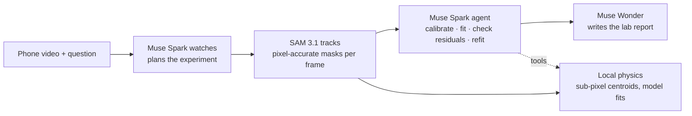

# Physicam

**Film anything that moves. Ask a question. Get a measurement with error bars.**


## Why

Lab motion sensors, photogates and high-speed trackers cost hundreds of
dollars, need setup, and only work in a teaching lab. Most students and
makers don't have them — but everyone has a phone camera, and modern phones
shoot 240 fps slow motion. Physicam turns that phone video into a
markerless motion-capture instrument: upload a clip, ask *"what is g?"*,
*"what's the coefficient of restitution?"* or *"what's the period?"* in
plain language, and get a fitted value with an honest uncertainty.

- **Science education labs** — free fall, projectile motion, pendulums and
  bounces measured from videos students shoot themselves.
- **Makers and engineers** — vibration, cycle times and mechanism tuning
  from a phone on a tripod, no encoder or accelerometer to wire up.
- **Research** — quick behaviour tracking and materials tests (drop tests,
  restitution, damping) before committing to instrumented rigs.

## How it works



| Meta model | How Physicam uses it |
| --- | --- |
| Muse Spark (`muse-spark-1.3`) | Watches a 640 px / 30 fps proxy video and returns a strict-JSON experiment plan (objects, 2–4 short SAM prompts per object, physical model, reference candidates). Then runs as the tool-calling agent (≤ ~12 steps): tracks, calibrates, fits, inspects residuals and refits. Also transcribes spoken questions via the voice endpoint used by the mic button. |
| SAM 3.1 (`sam-3.1`) | Video concept segmentation, one request per short noun phrase ("red ball", "spring"). Returns per-frame boxes and compressed masks, parsed with the official `meta-sam-parser`. Image mode calibrates reference objects in a still frame. |
| Muse Wonder (`muse-wonder-1.0`) | Writes only the final lab report (markdown) from the finished result JSON. Slower and pricier, so it is used once, at the end. |

Every Meta call goes through `physicam/meta_client.py`, and expensive
results are cached on disk under `data/cache/` keyed by the video's
SHA-256 plus request parameters, so demos replay instantly and offline.

### Physics details

- **Sub-pixel centroids.** Each SAM mask raster is decoded and its
  mask-weighted centroid, bounding box, area and equivalent diameter are
  computed per frame. Mask weighting gives sub-pixel positions even though
  the raster is smaller than the frame. Tracks are stitched across
  occlusions and de-duplicated (SAM ids are not stable through exit and
  re-entry).
- **Calibration hierarchy.** (1) A reference object of known size segmented
  in a frame; (2) the tracked object's known diameter from its mask size;
  (3) **gravity as a ruler** — assume g = 9.81 m/s² and solve for the scale
  (reported honestly as `method: gravity`); (4) no calibration, in which
  case results stay in pixel units rather than inventing metres.
- **Models.** Free fall / projectile, bounce (per-flight parabolas,
  per-impact restitution, pooled g), pendulum and spring oscillator
  (damped sinusoid; period, damping, Q, and g from a known length with the
  finite-amplitude correction), constant velocity, and generic polynomials.
  All fits run in pixel space with image y pointing down, then convert
  through the calibration.
- **Uncertainties.** Curve-fit covariance (for restitution, the full
  velocity covariance including the linear coefficient and the
  quadratic/linear cross term) combined in quadrature with the
  calibration's relative uncertainty. Restitution is cross-checked against
  `sqrt(h_next/h_prev)` from apex heights.
- **Outlier handling.** One pass of MAD-based residual rejection per fit,
  flight-quality gates in the bounce fit (a non-ballistic flight is
  excluded from the pooled g rather than poisoning it), and per-segment
  consistency warnings.
- **Strobe composite.** A textbook stroboscopic photo is built locally
  from the cached SAM masks: object pixels from every k-th frame pasted
  onto a temporal-median background plate (the pipeline step that produced
  the figure in the report).

## Validation

Measured on the bundled examples (`examples/`, CC BY-SA clips from
Wikimedia Commons; see [examples/ATTRIBUTION.md](examples/ATTRIBUTION.md)).
Both runs are replayable without new API calls from the disk cache.

| Example | Measured | Known / expected | Error / note |
| --- | --- | --- | --- |
| Bouncing ball, 240 fps | e = 0.698 ± 0.004 (one clean impact; velocity ratio, height cross-check e_h = 0.83 on that impact — the two methods bracket the value) | No certified value for this ball; typical bouncy balls are e ≈ 0.7–0.9 | Consistent with a lively rubber ball. g is reported in px/s² only (pooled 4692 ± 14 px/s²): there is no ruler in frame. **Perspective caveat:** the ball moves toward/away from the camera, so the pooled pixel-g carries a per-segment spread warning (≈ 6 %) and the powered throw segment (fitted acceleration upward) is excluded — pixel-g from this clip must not be read as 9.81 m/s². |
| Spring pendulum, 30 fps | T = 0.9633 ± 0.0003 s (damped sinusoid on the dominant axis, R² = 0.965; refit on 2–12 s: 0.9638 ± 0.0005 s) | No certified period for this rig; period needs no spatial calibration, only the 30 fps time base | Two independent windows agree to 0.05 %. The pendulum-model fit agrees (0.9648 ± 0.0010 s) but with a poor pivot fit, so the oscillator fit is the headline. |

Spark's guesses of real object sizes are unreliable (the same ball was
estimated at 0.15 m and 0.07 m), so they are treated as weak priors;
explicit references win whenever one is available.

## Quickstart

```bash
python -m venv .venv && .venv/bin/pip install -r requirements.txt
export MODEL_API_KEY=...        # or META_API_KEY
.venv/bin/python -m physicam serve --host 0.0.0.0 --port 8000
```

Open http://localhost:8000. The bundled examples work **without an API
key** (cached results). A static, backend-free demo can be built with
`.venv/bin/python scripts/build_static.py` and served from any static
host under any sub-path.

CLI: `.venv/bin/python -m physicam analyze <video> "<question>"` ·
Tests: `.venv/bin/python -m pytest -q`

## Built during the hackathon with Muse Code

Physicam was built for the Meta Global AI Developer Hackathon (*Push the
Frontier*). The code was written by the Muse Code agent
(**muse-wonder-1.0**) from the task specs in
[docs/muse-code-tasks/](docs/muse-code-tasks/), with a human lead
engineer reviewing, validating against real footage and committing. The
specs are kept in the repo so judges can see exactly what was asked for
and check the result against it.

## Limitations and next steps

- **2D only.** A single camera measures a plane; motion toward or away
  from the camera appears as a scale change (see the bounce caveat
  above). Depth/perspective correction and stereo are next steps.
- **Rolling shutter and phone VFR.** Phone sensors skew fast motion and
  many phones record variable frame rates; Physicam normalises to CFR
  but cannot undo shutter skew. Capture-fps overrides help for slow-mo.
- **Multi-object interactions** (collisions, occlusion-heavy scenes)
  stress SAM track identity; stitching helps but is not perfect.
- **Next:** a live phone-capture PWA that guides framing and reference
  placement while recording, and on-device pre-checks of blur and lighting.

## Licence

Code: MIT — see [LICENSE](LICENSE). Third-party: `meta-sam-parser` is
under the SAM License; bundled example media are CC BY-SA 4.0 — see
[examples/ATTRIBUTION.md](examples/ATTRIBUTION.md).
