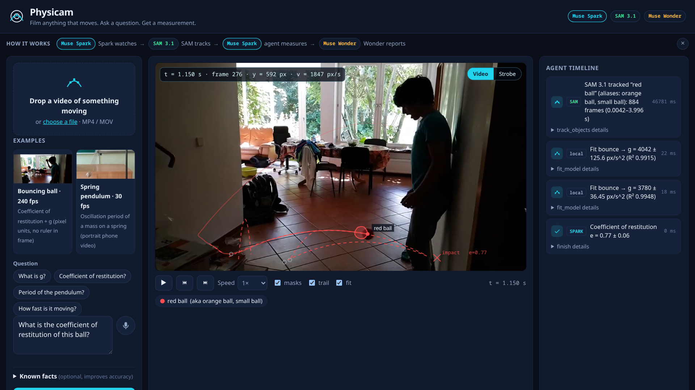
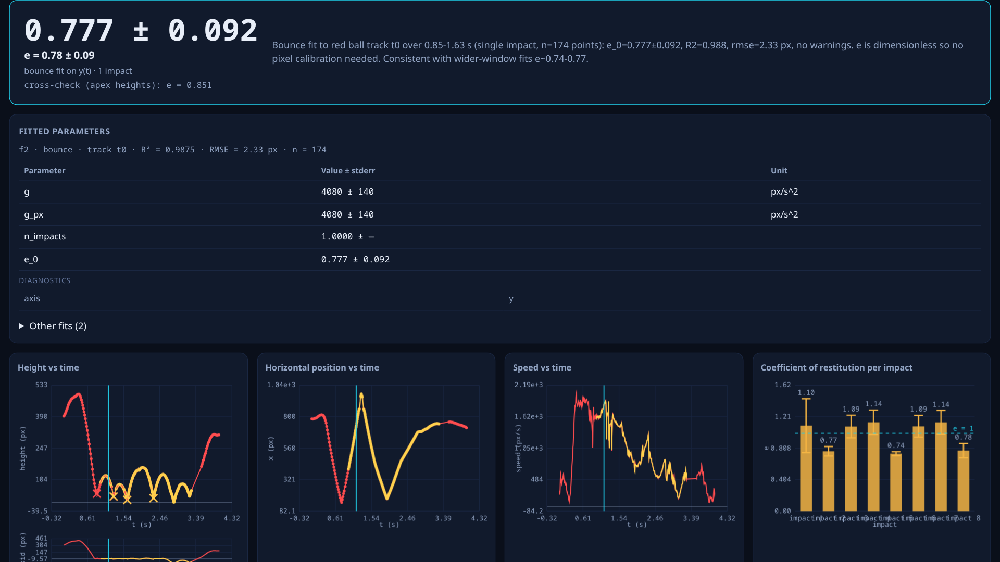
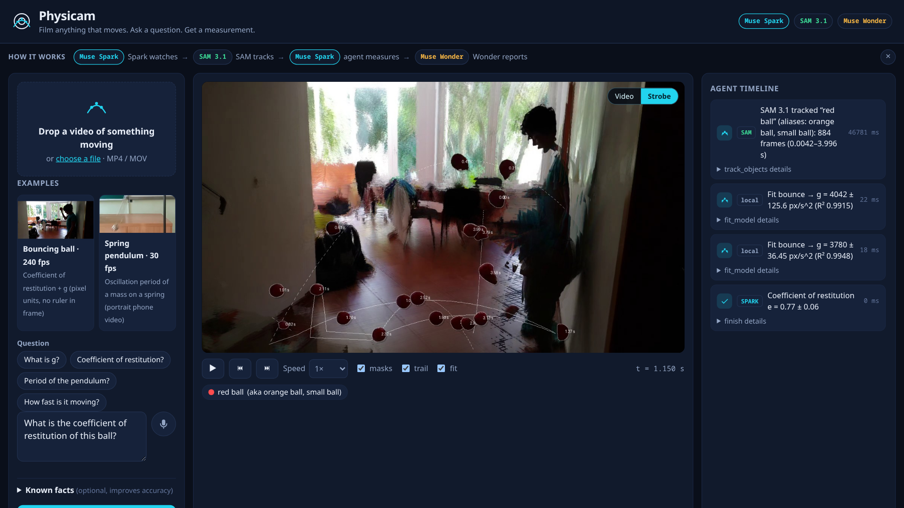
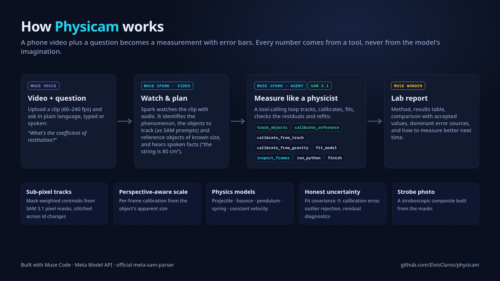
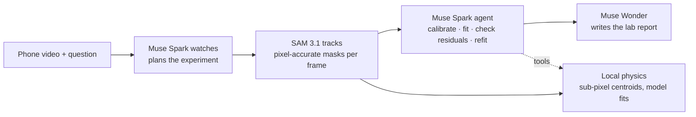

# Physicam

**Film anything that moves. Ask a question. Get a measurement with error bars.**

▶ **Demo video (3 min):** https://youtu.be/up0EUcCWzc4 · **Live static demo:** https://elvisclaros.github.io/physicam/



| Result with honest uncertainty | Stroboscopic composite from SAM masks |
| --- | --- |
|  |  |



## Why

Lab motion sensors, photogates and high-speed trackers cost hundreds of
dollars, need setup, and only work in a teaching lab. Most students and
makers don't have them — but everyone has a phone camera, and modern phones
shoot 240 fps slow motion. Physicam turns that phone video into a
markerless motion-capture instrument: upload a clip, ask *"what is g?"*,
*"what's the coefficient of restitution?"* or *"what's the period?"* in
plain language, and get a fitted value with an honest uncertainty.

- **A real lab I know first-hand.** In FIUBA's *Modelación Numérica* course
  (Universidad de Buenos Aires), we filmed a jar draining through a 5 mm hole
  and measured the water height **by hand** in ImageJ: 27 frames out of
  2471. Physicam measures every frame automatically, fits Torricelli's law
  with a discharge coefficient, and reproduces our manual curve (see
  Validation).
- **Science education labs** — free fall, projectile motion, pendulums and
  bounces measured from videos students shoot themselves.
- **Makers and engineers** — vibration, cycle times and mechanism tuning
  from a phone on a tripod, no encoder or accelerometer to wire up.
- **Research** — quick behaviour tracking and materials tests (drop tests,
  restitution, damping) before committing to instrumented rigs.

## How it works



| Meta model | How Physicam uses it |
| --- | --- |
| Muse Spark (`muse-spark-1.3`), video understanding | Watches a 640 px / 30 fps proxy of the clip **with its audio** and returns a strict-JSON experiment plan: phenomenon, 2–4 short SAM prompts per moving object, reference objects of standard size, and **spoken facts** ("the string is 80 cm") extracted into structured `facts_extracted`. |
| Muse Spark (`muse-spark-1.3`), tool-calling agent | Acts as an experimental physicist (≤ 12 steps) with tools: `track_objects`, `calibrate_reference`, `calibrate_from_track`, `calibrate_from_gravity`, `fit_model`, `inspect_frames` (Spark vision on extracted frames), `run_python` (sandboxed numpy/scipy, no keys or network) and `finish`. It must take every number in its answer from a tool output. In a real run, SAM found nothing for "silver metal weight"; the agent looked at frames, retried with "metal ball", split the fit into windows to check consistency, and only then answered. |
| SAM 3.1 (`sam-3.1`) | Video concept segmentation at full frame rate (240 fps clips included), with candidate prompts tracked **concurrently**. Masks are decoded with Meta's official `meta-sam-parser` and used quantitatively: sub-pixel centroids, apparent size for per-frame perspective correction, and the strobe composite. Image mode segments static reference objects for calibration. |
| Muse Wonder (`muse-wonder-1.0`) | Writes the final lab report (method, results table, comparison with accepted values, error sources, how to measure better) from the finished result JSON. |
| Muse Voice Transcribe (`muse-voice-transcribe-1.0`) | Hold-to-talk spoken questions in the UI (`POST /api/transcribe` converts browser audio to 16 kHz WAV and calls `/v1/asr/transcribe`). |
| Muse Code | Wrote the code base, milestone by milestone, from the specs in [docs/muse-code-tasks/](docs/muse-code-tasks/) (see below). |

Every Meta call goes through `physicam/meta_client.py`, and expensive
results are cached on disk under `data/cache/` keyed by the video's
SHA-256 plus request parameters, so demos replay instantly and offline.

### Physics details

- **Sub-pixel centroids.** Each SAM mask raster is decoded and its
  mask-weighted centroid, bounding box, area and equivalent diameter are
  computed per frame. Mask weighting gives sub-pixel positions even though
  the raster is smaller than the frame. Tracks are stitched across
  occlusions and de-duplicated (SAM ids are not stable through exit and
  re-entry).
- **Calibration hierarchy.** (1) Facts given by the user or **spoken in the
  video's narration**; (2) a reference object of standard size (A4 sheet,
  credit card…) segmented by SAM in a frame and measured by its **oriented
  extent** on the largest connected mask component (not ellipse axes, which
  overestimate a rectangle's side by 15.5 %), with an aspect-ratio check
  that flags a tilted sheet; (3) the tracked object's known
  diameter from its mask size; (4) **gravity as a ruler**: assume
  g = 9.81 m/s² and solve for the scale, never used when the question is
  about g, and reported as `method: gravity`; (5) no calibration, in which
  case results stay in pixel units rather than inventing metres.
- **Per-frame perspective correction.** A ball flying toward the camera
  looks like it accelerates. Under a pinhole camera, apparent size ∝ 1/depth,
  so Physicam rescales every frame by the object's smoothed apparent
  diameter from its SAM mask. On the real 240 fps bounce clip, this cut the
  disagreement between the g values of two flights from **5.68 % to
  0.27 %**. A constant scale is used when the size is stable.
- **Pendulum geometry.** A circle fit (Kåsa, then Gauss–Newton) to the
  bob's path gives the pivot and the length in pixels. The swing is fitted
  in the angle domain θ(t), corrected for finite amplitude
  (T₀ = T / (1 + θ₀²/16 + 11θ₀⁴/3072)), and turned into
  g = 4π²L/T₀² using a length heard in the narration, given by the user, or
  measured through the calibration. In a full nonlinear simulation
  (L = 0.80 m, θ₀ = 25°), g is recovered within 0.26 %; without the
  amplitude correction the error would be 2.1 %.
- **Models.** Free fall / projectile, bounce (per-flight parabolas,
  per-impact restitution, pooled g), pendulum and spring oscillator
  (damped sinusoid; period, damping, Q, and g from a known length with the
  finite-amplitude correction), constant velocity, and generic polynomials.
  All fits run in pixel space with image y pointing down, then convert
  through the calibration.
- **Liquid level and draining (Torricelli).** SAM 3.1 segments the liquid in
  every frame. The surface is the first mask row covering at least half of
  the median width, which makes it robust to the meniscus and the exit jet.
  h is measured above the **hole** (the level where draining stops), as
  Torricelli's law requires. The fit is sqrt(h) = sqrt(h0) − k(t − t0),
  giving the discharge coefficient Cd (with the approach-velocity
  correction) and the drain time. There is also a generalized-vessel ODE fit
  with A(h) taken from the mask's width profile (RK45), the course's
  empirical fits (quadratic, cubic, exponential), times to 10–90 % drained,
  and an h(t) CSV export.
- **Uncertainties.** Curve-fit covariance (for restitution, the full
  velocity covariance including the linear coefficient and the
  quadratic/linear cross term) combined in quadrature with the
  calibration's relative uncertainty. Restitution is cross-checked against
  `sqrt(h_next/h_prev)` from apex heights.
- **Outlier handling.** One pass of MAD-based residual rejection per fit,
  flight-quality gates in the bounce fit (a non-ballistic flight is
  excluded from the pooled g rather than poisoning it), and per-segment
  consistency warnings.
- **Strobe composite.** A textbook stroboscopic photo is built locally
  from the cached SAM masks: object pixels from every k-th frame pasted
  onto a temporal-median background plate (the pipeline step that produced
  the figure in the report).

## Validation

Measured on the bundled examples (`examples/`, CC BY-SA clips from
Wikimedia Commons; see [examples/ATTRIBUTION.md](examples/ATTRIBUTION.md)).
Both runs are replayable without new API calls from the disk cache.

| Example | Measured | Known / expected | Error / note |
| --- | --- | --- | --- |
| Bouncing ball, 240 fps: throw 1 (bundled example) | e = 0.70 ± 0.12 (velocity ratio at the one clean impact; the apex-height cross-check gives e_h = 0.83) | No certified value for this ball; lively rubber balls are typically e ≈ 0.7–0.9 | The large error bar is deliberate: residuals are inflated by √χ²ᵣ, and the ball moves toward the camera. g stays in px/s² (no ruler in frame); the powered throw segment is detected and excluded. |
| Same ball: throw 2 (a different 4 s of the same video, analysed live several times) | e = 0.78 ± 0.09, 0.77 ± 0.06 (independent live runs; the agent picks its own fit window) | Throw 1 above | **Consistent** with throw 1 within the error bars. Two independent throws of the same ball give the same e, and repeated agent runs agree with each other. |
| Spring pendulum, 30 fps | T = 0.963 ± 0.006 s (damped oscillator; σ includes split-half consistency, T₁ = 0.961 s vs T₂ = 0.967 s) | No certified period for this rig. A period needs no spatial calibration, only the 30 fps time base | The pendulum circle fit was rejected (pivot not above the bob: this is a spring, not a rigid pendulum), so the agent switched to the oscillator model and confirmed it on a sub-window. |
| **Draining jar, real FIUBA lab** (60 fps, 5 mm hole, 7.5 cm jar) | Level in all 2471 frames. **Cd = 0.56 ± 0.03**, drains in **46.2 ± 0.9 s** (ideal Torricelli with Cd = 1: 25.8 s). Times to 10/25/50/75/90 % drained: 2.37, 6.19, 13.53, 23.10, 31.59 s | Our team's manual ImageJ measurements (27 frames): 2.22, 5.99, 13.22, 22.58, 30.71 s | Curve shape (h/h0): **RMS 2.6 %** of h0 with no scale fitting. Physicam's times run 2–7 % later, a systematic offset that is not yet explained. The absolute h0 comes out 10 % high (6.46 vs 5.86 cm) because calibrating on the jar width is biased by refraction in the curved glass; Physicam flags this, and a vertical ruler fixes it. |
| Synthetic nonlinear pendulum (tests) | g = 9.836 ± 0.063 m/s² from L = 0.80 m, θ₀ = 25° | 9.81 m/s² | 0.26 % error, within 1σ. Without the finite-amplitude correction the error is 2.1 %. |

Spark's guesses of real object sizes are unreliable (the same ball was
estimated at 0.15 m and 0.07 m), so they are treated as weak priors;
explicit references win whenever one is available.

## Quickstart

```bash
python -m venv .venv && .venv/bin/pip install -r requirements.txt
export MODEL_API_KEY=...        # or META_API_KEY
.venv/bin/python -m physicam serve --host 0.0.0.0 --port 8000
```

Open http://localhost:8000. The bundled examples work **without an API
key** (cached results). A static, backend-free demo can be built with
`.venv/bin/python scripts/build_static.py` and served from any static
host under any sub-path.

CLI: `.venv/bin/python -m physicam analyze <video> "<question>"` ·
Tests: `.venv/bin/python -m pytest -q`

## Built during the hackathon with Muse Code

Physicam was built for the Meta Global AI Developer Hackathon (*Push the
Frontier*), from scratch, on Nov 3–4, 2026; the git history shows the
progression. The code was written by the Muse Code agent
(**muse-wonder-1.0**, running headless with `muse exec` in a sandboxed
container) from the task specs in
[docs/muse-code-tasks/](docs/muse-code-tasks/). Each milestone was then
reviewed, validated against real footage and committed by the project lead.
Some milestones ran in parallel (backend and UI against a shared JSON
contract in [AGENTS.md](AGENTS.md)). The specs are kept in the repo so you
can see exactly what was asked for and check the result against it.

| Spec | What Muse Code built |
| --- | --- |
| [01-core](docs/muse-code-tasks/01-core.md) | Meta client, video I/O, SAM 3.1 tracking + stitching, calibration, physics fits, tests |
| [02-agent-server](docs/muse-code-tasks/02-agent-server.md) | Spark planner, tool-calling agent, sandbox, Wonder report, pipeline, FastAPI + SSE, perspective correction |
| [03-web-ui](docs/muse-code-tasks/03-web-ui.md), [04a](docs/muse-code-tasks/04a-ui-fixes.md) | The instrument UI: overlays, linked charts, timeline, strobe view |
| [04-integration-strobe](docs/muse-code-tasks/04-integration-strobe.md) | End-to-end contract fixes found on real runs, concurrent tracking, strobe composite |
| [05-examples-readme-static](docs/muse-code-tasks/05-examples-readme-static.md) | Examples, docs, static demo mode |
| [06-pendulum-g](docs/muse-code-tasks/06-pendulum-g.md) | Circle-fit pendulum, finite-amplitude correction, spoken-length facts |
| [07-final-polish](docs/muse-code-tasks/07-final-polish.md) | Honest split-half uncertainties, report figure, provenance line |

## Limitations and next steps

- **Mostly 2D.** A single camera measures a plane. Motion toward or away
  from the camera is corrected through per-frame scale only when the
  object's real size is known. Full 3D trajectories (depth from apparent
  size, with gravity calibrating the focal length) are a next step.
- **Rolling shutter and phone VFR.** Phone sensors skew fast motion and
  many phones record variable frame rates; Physicam normalises to CFR
  but cannot undo shutter skew. Capture-fps overrides help for slow-mo.
- **Multi-object interactions** (collisions, occlusion-heavy scenes)
  stress SAM track identity; stitching helps but is not perfect.
- **Next:** a live phone-capture PWA that guides framing and reference
  placement while recording, and on-device pre-checks of blur and lighting.

## Licence

Code: MIT — see [LICENSE](LICENSE). Third-party: `meta-sam-parser` is
under the SAM License; bundled example media are CC BY-SA 4.0 — see
[examples/ATTRIBUTION.md](examples/ATTRIBUTION.md).
